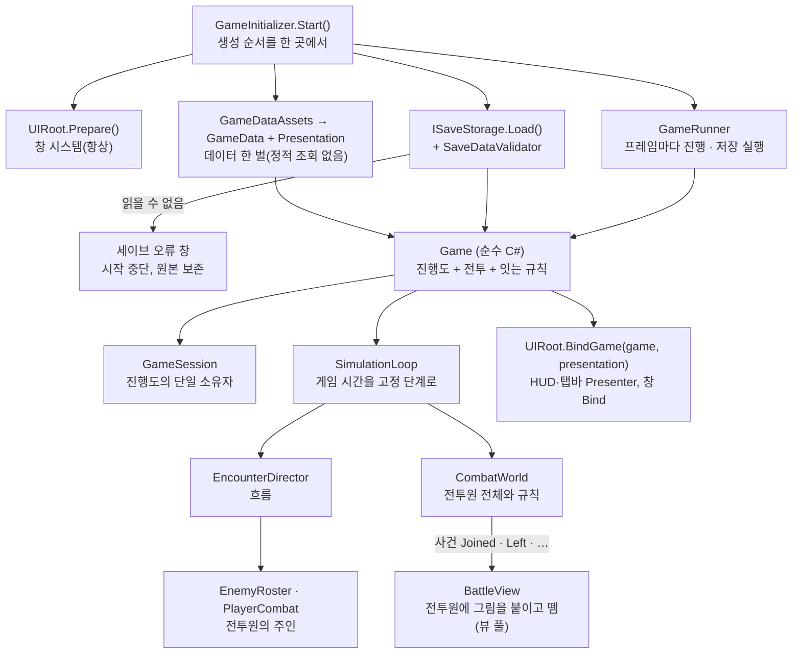
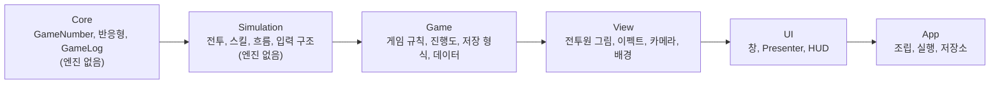
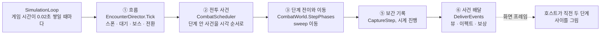
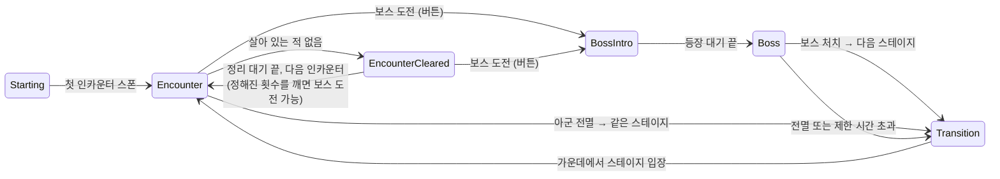
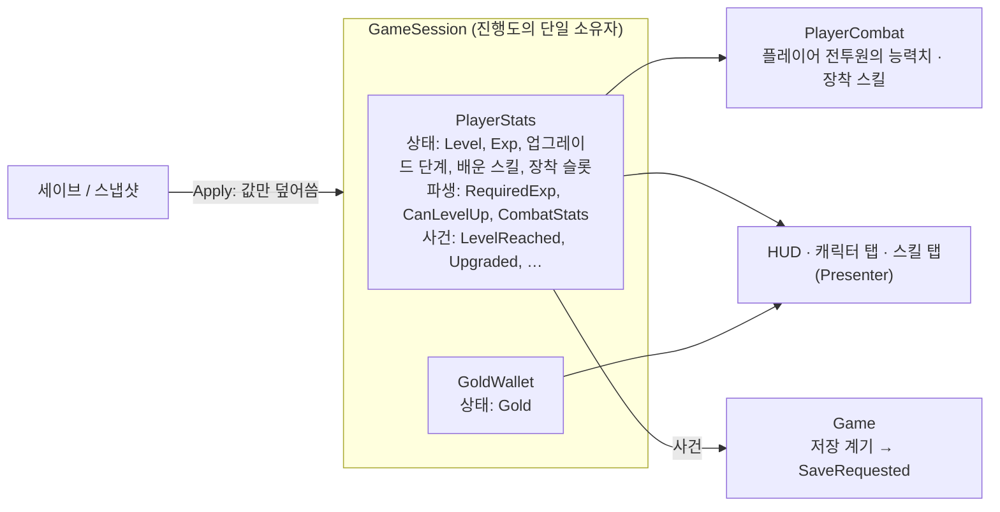
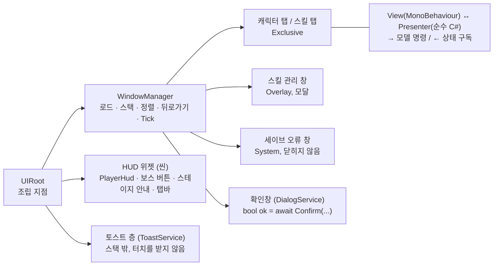
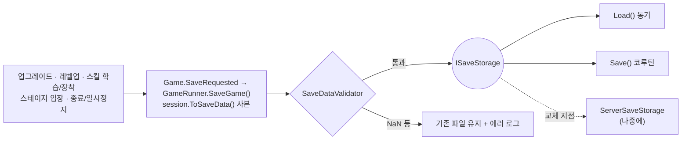

# 2D 방치형 게임

데이터 기반 설계로 만든 2D 방치형 액션 RPG 프로토타입입니다.

- 엔진: Unity 6000.4.9f1 (Unity 6)
- 목표 플랫폼: Android (최종 확인은 실기기). WebGL은 데모용
- 개발 기간: 2026.06 ~ 진행 중

## 직접 플레이
https://answk427.itch.io/unityidlegame

> 데모와 아래 영상은 전투·흐름·UI 구조를 다시 만들기 전 버전입니다. 게임 규칙(전진, 전투, 보스, 업그레이드, 스킬)은 같고, 내부 구조는 이 문서가 설명하는 지금 코드와 다릅니다.

## 목차

- [플레이영상](#플레이영상)
- [핵심 설계](#핵심-설계)
- [핵심 게임플레이](#핵심-게임플레이)
- [아키텍처](#아키텍처)
- [테스트와 검증](#테스트와-검증)
- [트러블슈팅](#트러블슈팅)
- [알려진 한계](#알려진-한계)
- [프로젝트 구조](#프로젝트-구조)

## 플레이영상

### 전체 게임 흐름
<video src="https://github.com/user-attachments/assets/57aa869b-a915-4c2d-8710-8e1918ef657a" width="100%" controls></video>
> 플레이어가 계속 이동 -> 마주치는 적과 전투 -> 보스 처치 후 다음 스테이지

### 사망 시 재시작
<video src="https://github.com/user-attachments/assets/12351cfa-88f5-491b-9cdf-7cd9a5ca42fc" width="100%" controls></video>
> 실패한 스테이지를 반복

### 스탯 업그레이드
<video src="https://github.com/user-attachments/assets/3f65d934-b512-4791-ba4c-0366af8dd589" width="100%" controls></video>
> 골드를 소모해 스탯 업그레이드

## 핵심 설계

1. **엑셀 → JSON → ScriptableObject 데이터 파이프라인**: 기획 데이터는 엑셀 하나가 원본입니다. 변환기는 리플렉션으로 데이터 타입을 찾아 열을 필드에 맞추고, 없는 열·형식이 틀린 값·같은 키가 하나라도 있으면 아무것도 바꾸지 않습니다(예전에는 조용히 0이 됐습니다). 프리팹·배경은 이름으로 자동 연결하고, 손으로 연결한 아이콘·VFX는 다시 변환해도 남습니다.
2. **전투원은 하나, 차이는 데이터**: 플레이어·일반 몬스터·보스가 모두 순수 C# `Combatant` 하나입니다. 공격 간격이 있으면 기본 공격, 스킬 id가 있으면 스킬, 이동 정책(제자리/접근)이 이동 방식을 정합니다. 엑셀에 슬라임의 공격 간격만 넣으면 코드 수정 없이 공격합니다.
3. **결정적인 전투 시뮬레이션**: 전투는 고정 타임스텝(0.02초)으로만 돌고, 시계 하나·절대 시각·시간 순서 사건 처리로 진행합니다. 행동의 길이는 데이터가, 타격 시점은 행동 시간표가 정하고 애니메이션은 그것을 재생만 합니다. 그래서 30fps, 120fps, 렉이 섞여도, 애니메이터를 꺼도 처치·타격 시각이 같습니다(씬 없이 실제 데이터로 돌리는 헤드리스 실행으로 테스트).
4. **흐름과 진행도는 한 주인, 바깥에는 반응형 값**: 인카운터·보스·스테이지 전환은 `EncounterDirector` 하나가, 저장되는 진행도는 `GameSession` 하나가 갖습니다. 바깥에는 상태(`ReactiveProperty`)·파생 상태·사건(`Subject`)으로 내보내서, 진행도를 통째로 바꿔도(세이브 로드, 서버 롤백 자리) 화면과 캐릭터가 따라옵니다.
5. **창 관리자 + View/Presenter UI**: 창은 전부 `WindowManager`가 열고 닫습니다(정렬 구분, 스택, 뒤로가기, 입력 차단). 화면 로직은 uGUI를 모르는 순수 C# Presenter에 있어서 가짜 View로 테스트합니다.
6. **진행도를 잃지 않는다**: 세이브는 변환 전에 검사하고, 읽을 수 없으면 새 데이터로 덮어쓰는 대신 시작을 멈추고 "세이브 파일은 바꾸지 않았다"를 알립니다.

## 핵심 게임플레이

- 캐릭터가 앞으로 계속 전진 -> 몬스터를 만나면 자동 전투
- 몬스터 무리를 일정 횟수 처치하면 보스 도전 버튼이 열리고, 보스를 처치하면 다음 스테이지로 전환. 아군이 전멸하면 같은 스테이지를 처음부터
- 경험치가 차면 레벨업 버튼, 골드로 체력 / 공격력 / 공격속도 업그레이드
- 스킬 학습 → 슬롯 배치 → 쿨다운이 차면 자동 사용(피해 / 광역 피해 / 회복), 슬롯을 누르면 다음 기회에 사용
- 골드·상자 드랍, 데미지·힐 숫자, 히트 파티클 등 전투 피드백

## 아키텍처

### 1. 전체 구조


> 게임 규칙은 전부 `Game`(순수 C#) 안에 있고, Unity 쪽은 조립(`GameInitializer`), 실행(`GameRunner`), 그림(`BattleView`, 이펙트, UI)만 합니다. 그래서 씬 없이 `Game` 하나를 돌린 기록이 에디터 플레이 기록과 비트 단위로 같습니다. 모든 구독을 연결한 뒤 흐름을 시작하므로 처음 값도 그대로 전달됩니다.

([GameInitializer.cs](Assets/Scripts/App/GameInitializer.cs), [Game.cs](Assets/Scripts/Game/Game.cs), [GameData.cs](Assets/Scripts/Game/GameData.cs), [BattleView.cs](Assets/Scripts/View/BattleView.cs), [GameRunner.cs](Assets/Scripts/App/GameRunner.cs))

**어셈블리는 한 방향입니다.** 폴더 하나가 어셈블리 하나이고, 위 규칙들을 컴파일러가 강제합니다.


> 화살표 방향으로만 참조합니다(오른쪽이 왼쪽을 안다). Core와 Simulation은 Unity를 참조하지 않아서 `Debug`·`Mathf`·`Time`이나 데이터 행·에셋을 쓰면 컴파일되지 않습니다. 시뮬레이션은 값만 받고(`SkillSpec`, `StageSpec`, `ActionTiming`, `CombatantSpec`, 만드는 곳은 `GameData` 한 곳), 바깥(뷰, UI, 앱)은 `Game`에서 읽기 전용 접점(`IReadOnlyCombatWorld`, `IEncounterFlow`)만 받습니다. 컴파일된 참조 방향과 "바깥이 전투를 진행하는 형식을 쥐지 않는다"는 테스트(`ArchitectureTests`)가 다시 확인합니다. 개발자 도구는 그 위의 별도 어셈블리이고 릴리스 빌드에는 없습니다.

([ArchitectureTests.cs](Assets/Tests/EditMode/ArchitectureTests.cs), [ReadOnlyCombat.cs](Assets/Scripts/Simulation/Combat/ReadOnlyCombat.cs), [IEncounterFlow.cs](Assets/Scripts/Simulation/Flow/IEncounterFlow.cs))

---

### 2. 데이터 파이프라인: Excel → JSON → ScriptableObject
<video src="https://github.com/user-attachments/assets/86fc8e3e-2afe-4501-b435-67a08636b12a" width="100%" controls></video>
> 엑셀 시트 기준 변환, IData를 구현한 클래스로 변환 가능

```
DataTables/GameData.xlsx (원본, 시트 이름 = JSON 이름 = 데이터베이스 에셋 이름)
        │  ExcelToJsonConverter (Editor, ExcelDataReader로 파싱)
        │  - IData 구현 클래스를 리플렉션으로 탐색, 엑셀 열 ↔ 직렬화 필드 매칭
        │  - 없는 열 / 남는 열 / 형식 오류 / 같은 키 → 전부 거부, 아무것도 바꾸지 않음
        ▼
Resources/Data/*.json (Newtonsoft.Json)
        │  IDataSyncer 구현체를 리플렉션으로 탐색해 타입별로 디스패치
        ▼
ScriptableObject 데이터베이스 (Monster / Stage / Skill / PlayerStat / Character)
        │  프리팹·배경은 이름으로 자동 연결(못 찾으면 기존 연결 유지 + 경고)
        │  아이콘·VFX·SFX 등 엑셀에 없는 값은 보존
        ▼
GameDatabaseManager → 런타임
```

- 새 데이터 테이블은 데이터 클래스와 `IDataSyncer` 구현 하나로 추가되고, 변환기 본체는 고치지 않습니다.
- **에디터에서 값만 바꿔 보기**는 튜닝 덮어쓰기(메뉴 `IdleGame/Data/Tuning Overrides`)로 합니다. 플레이 중 데이터베이스 사본에만 적용되고 엑셀과 에셋은 그대로이며, 빌드에는 이 코드가 없습니다.
- 데이터와 프리팹의 짝(공격 간격이 있으면 공격 시간표, 스킬 행동 키, 판정 몸 등)은 에디터와 빌드가 검사합니다.

([ExcelToJsonConverter.cs](Assets/Editor/DataImporter/ExcelToJsonConverter.cs), [IDataSyncer.cs](Assets/Editor/DataImporter/IDataSyncer.cs), [DataTuning.cs](Assets/Scripts/Game/Data/DataTuning.cs))

---

### 3. 전투: 전투원 하나, 월드 하나, 고정 타임스텝



- **`Combatant`(순수 C#)**: HP(`GameNumber`), 단계 값 하나(`Inactive / Moving / Engaged / Dead`, 상태 객체 없음), 행동. 호스트(MonoBehaviour)는 그리기와 Unity 연결만 합니다. 보스는 따로 클래스가 없고 스폰할 때 정하는 역할입니다.
- **`CombatWorld`**: 전투원 전체와 규칙을 갖습니다. 거리 규칙은 **표면 거리** 하나(중심 거리 − 두 반너비)이고 교전·단일 대상·범위 스킬이 모두 이것을 씁니다. 대상은 반대 팀의 살아 있는 가장 가까운 전투원(앞뒤 무관)입니다.
- **시간 모델**: `SimClock`이 유일한 시계이고 모든 시각은 절대 시각(초, double)입니다. 행동의 시작·끝·타격 시각과 스킬 준비 시각은 한 번 계산해 저장하고 다시 계산하지 않아서, 같은 시각 비교가 정확히 같습니다(여유값 없음). `CombatScheduler`가 한 단계 안의 모든 전투원의 사건을 시각 순서로 처리하므로, 0.005초에 죽은 전투원은 0.018초의 타격을 하지 않습니다.
- **공간**: 플레이어가 월드에서 실제로 전진하고 카메라가 따라갑니다. 시체·동전·이펙트처럼 가만히 있는 것은 아무 처리 없이 화면에서 지나갑니다. 이동은 sweep 하나(그 방향의 가장 가까운 살아 있는 몸까지만)라서 한 단계 이동량과 상관없이 몸을 통과하지 않습니다(이동 속도 1e6에서 테스트). 인카운터마다 원점을 재설정해 오래 달려도 좌표가 커지지 않습니다.
- **전투 중 할당 0**: 범위·스킬 결과는 재사용 버퍼, 몬스터 전투원은 풀 객체마다 하나를 다시 씁니다(테스트로 확인).

([Combatant.cs](Assets/Scripts/Simulation/Combat/Combatant.cs), [CombatWorld.cs](Assets/Scripts/Simulation/Combat/CombatWorld.cs), [CombatScheduler.cs](Assets/Scripts/Simulation/Combat/CombatScheduler.cs), [SimClock.cs](Assets/Scripts/Simulation/Combat/SimClock.cs), [SimulationLoop.cs](Assets/Scripts/Simulation/Flow/SimulationLoop.cs), [GameRunner.cs](Assets/Scripts/App/GameRunner.cs))

---

### 4. 행동 시간표와 스킬

<video src="https://github.com/user-attachments/assets/dcd362f5-cd88-47b0-9840-fc482eaa7fbd" width="100%" controls></video>
> 스킬 배치 -> 배치된 스킬 자동 사용

- **전투 규칙을 애니메이션이 정하지 않습니다.** 행동의 길이는 데이터(기본 공격 = 공격 간격, 스킬 = `castTime`), 타격 시점은 행동 시간표(`ActionTimeline`)의 비율입니다. 시간표는 클립의 타격 표식 이벤트를 에디터 메뉴로 비율로 구운 값이고, 클립이 바뀌었는데 다시 굽지 않으면 에디터가 에러를 내고 빌드가 실패합니다. 애니메이터는 상태를 이름으로 재생하는 재생기이고, 클립은 데이터 길이에 맞춰 재생 속도가 바뀝니다(아트를 바꿔도 밸런스가 안 바뀝니다).
- **취소 없음**: 모든 행동은 끝까지 하고, 다음 행동은 지금 행동이 완료된 시각에 정합니다(수동 요청 → 슬롯 순서 → 기본 공격). 행동을 끊는 것은 사망과 교전 종료뿐입니다. 타격 순간에 대상을 다시 확인하고, 없으면 헛칩니다.
- **스킬 효과는 Strategy**: `Skill`이 수치(`SkillData`)와 효과(`ISkillBehavior`: 피해 / 광역 피해 / 회복)를 묶고, 효과는 데이터의 `effectType`으로 고릅니다. 같은 효과의 새 스킬은 데이터만 추가합니다. 쿨다운은 슬롯이 아니라 스킬 id에 붙어서 슬롯을 옮기거나 풀었다 껴도 유지됩니다.

([ActionRunner.cs](Assets/Scripts/Simulation/Combat/ActionRunner.cs), [ActionTimeline.cs](Assets/Scripts/Game/Data/ActionTimeline.cs), [CombatActions.cs](Assets/Scripts/Simulation/Combat/CombatActions.cs), [Skill.cs](Assets/Scripts/Simulation/Skill/Skill.cs), [SkillLoadout.cs](Assets/Scripts/Simulation/Combat/SkillLoadout.cs))

---

### 5. 흐름: `EncounterDirector`



- 흐름은 순수 C#이고 고정 단계 ①에서 돕니다. 전투 알림(사망 등)이 흐름을 직접 부르지 않고, 흐름이 지난 단계의 결과(보스 처치, 전멸)를 월드에 묻습니다(재진입 없음). 같은 단계에 처치와 전멸이 보이면 클리어가 먼저입니다.
- **명령은 검사와 결과는 즉시, 실행은 다음 단계**: `RequestBossChallenge()`(받음 / 지금은 불가 / 바쁨), `RestartAt(스테이지)`. 보스 버튼, 개발자 도구, 진행도 교체가 모두 이것만 부릅니다.
- 대기 시간(정리, 보스 등장, 전환)과 보스전 제한 시간은 데이터이고, 시뮬레이션 시간이라 배속과 프레임률에 상관없이 같은 시각에 일어납니다. 화면 페이드는 그 시간을 그리기만 합니다.
- 개발 빌드에서는 게임 시간 30초 동안 피해·사망·이동·흐름 변화가 없으면 경고합니다(진전 감시).

([EncounterDirector.cs](Assets/Scripts/Simulation/Flow/EncounterDirector.cs), [FlowTypes.cs](Assets/Scripts/Simulation/Flow/FlowTypes.cs))

---

### 6. 진행도와 반응형 모델



- **상태와 사건을 구분합니다.** "지금 값이 있나?"가 기준입니다: 골드·레벨은 상태(`ReactiveProperty`: 구독하는 순간 지금 값을 주고 같은 값은 무시), 레벨업 순간·몬스터 사망은 사건(`Subject`). 구독하는 쪽의 모양은 둘 다 `Subscribe → IDisposable`이라 해제 누락이 없습니다. 반응형 타입은 R3와 같은 모양으로 직접 만들었습니다.
- **파생 상태(`DerivedProperty`)는 저장 데이터에서 계산**해서, 교체 도중의 조합(새 레벨 + 옛 업그레이드)이 바깥에 보이지 않습니다.
- **`GameSession.Apply`는 객체를 새로 만들지 않고 값만 덮어씁니다.** 구독하는 쪽이 옛 객체를 붙잡지 않으므로 세이브 로드, 개발자 도구의 진행도 교체, (나중의) 서버 롤백이 같은 경로를 씁니다.
- **재화와 전투 수치는 `GameNumber`**(내부 double)로 감쌌습니다. 방치형 경제는 상한 없이 커지므로, 표현을 바꿔야 할 때 구조체 내부만 바뀌게 했습니다. 세이브와 데이터 테이블에는 기본 타입을 둡니다(직렬화 모양을 바꾸지 않기 위해).
- 전투 → 연출·보상 방향의 알림은 월드의 사건(`CombatEvent`, 구조체라 할당 없음)입니다. 시뮬레이션은 일어난 일을 버퍼에 쌓기만 하고, 드라이버가 고정 단계가 끝난 뒤 뷰·이펙트·보상에 배달합니다. 그래서 연출이 시뮬레이션 도중에 끼어들 수 없고, 연출을 바꾸거나 빼도 결과가 같습니다. 처치 보상은 스폰할 때 전투원에 넣고 사망 사건이 싣고 가서 `Game`이 지급합니다.

([GameSession.cs](Assets/Scripts/Game/Progress/GameSession.cs), [PlayerStats.cs](Assets/Scripts/Game/Progress/PlayerStats.cs), [ReactiveProperty.cs](Assets/Scripts/Core/Reactive/ReactiveProperty.cs), [DerivedProperty.cs](Assets/Scripts/Core/Reactive/DerivedProperty.cs), [GameNumber.cs](Assets/Scripts/Core/Economy/GameNumber.cs), [CombatEvent.cs](Assets/Scripts/Simulation/Combat/CombatEvent.cs))

---

### 7. UI: 창 관리자와 View / Presenter



- **그리는 순서는 코드의 정렬 구분**(`UISortBand`: Fx 0 · Hud 1000 · Window 2000 · Popup 3000 · Toast 4000 · System 9000)이고, 창의 sortingOrder = 구분 + 깊이 × 10입니다. 데미지 숫자는 HUD 아래, 탭 내용은 HUD 위, 모달 딤은 맨 위 모달 바로 아래에 놓입니다.
- **스택은 [로드된 창: 구분 순] + [로드 중인 창]**이라 스택 맨 위가 화면 맨 위이고, 뒤로가기는 화면 맨 위 창부터 닫습니다. 탭(Exclusive)은 열릴 때 System 구분 밑의 창을 닫는데, 스택 방식도 프리팹을 로드해야 알기 때문에 **자기보다 먼저 열기를 요청한 창에만** 적용합니다(나중에 요청한 팝업은 새 탭 위에 남고, 로드가 실패하면 이전 탭이 그대로).
- **창의 구조는 코드**(`WindowOptions`: 구분, 스택 방식, 모달, 바깥 터치, 뒤로가기), 연출(딤 색 등)만 프리팹입니다. 인자 타입이 자기 창을 가리켜서(`IWindowArgs<TWindow>`) 다른 창의 인자를 넘기면 컴파일되지 않고, 닫힘과 결과는 `await handle.Closed`로 기다립니다.
- **Presenter는 uGUI·싱글턴을 모릅니다.** 서비스(토스트, 확인창 포함)를 생성자로 받고, 구독은 창 수명에 묶어 닫힐 때 한 번에 해제합니다. 명령이 실패하면 결과의 이유("골드가 부족합니다", "Lv.3부터 배울 수 있습니다")를 토스트로 알립니다. 버튼은 꺼 두지 않고 모양만 불가로 보여서(`UIButton.Available`) 눌렀을 때 이유가 나옵니다.
- **해금과 레드닷은 게임 규칙이라 게임 쪽 파생 상태입니다.** 탭은 "창이 연결되고 게임 쪽에서 해금된 탭만" 열립니다(조건은 엑셀 `ContentUnlockDatabase` 시트). 해금은 저장하지 않고 레벨·스테이지에서 계산해서 세이브 형식이 바뀌지 않습니다. 레드닷 조건(레벨업 가능, 살 수 있는 업그레이드, 배울 스킬)도 진행도의 파생 상태이고, 어느 버튼에 묶을지만 UI가 정합니다.
- 입력 차단(`InputBlocker`)은 참조 카운트와 스코프 해제로, 창을 여는 동안과 화면 전환 중에 걸립니다. 모달이 떠 있으면 키보드 이동도 막습니다. 차단막이 켜진 그 프레임의 틈(새 그래픽은 그려지기 전 레이캐스트에 안 잡힘)은 "UI 버튼 클릭은 한 프레임에 하나"(`UIButton`) 규칙이 막습니다. 창이 하나도 없을 때 뒤로가기는 종료 확인창입니다.

([UIRoot.cs](Assets/Scripts/UI/Core/UIRoot.cs), [WindowManager.cs](Assets/Scripts/UI/Core/WindowManager.cs), [WindowOptions.cs](Assets/Scripts/UI/Core/WindowOptions.cs), [UIButton.cs](Assets/Scripts/UI/Core/UIButton.cs), [ToastService.cs](Assets/Scripts/UI/Toast/ToastService.cs), [DialogService.cs](Assets/Scripts/UI/Dialog/DialogService.cs), [TabBarPresenter.cs](Assets/Scripts/UI/Tabs/TabBarPresenter.cs), [ContentUnlocks.cs](Assets/Scripts/Game/Progress/ContentUnlocks.cs))

---

### 8. 저장 시스템



- **손상된 세이브는 새 데이터로 대신하지 않습니다.** `JsonUtility`는 없는 필드를 기본값으로 채워서 변환 뒤에는 손상을 알 수 없으므로, 변환 전에 필수 키·타입·하한·슬롯 길이·중복 키를 봅니다. 파일이 없을 때만 새로 시작하고, 읽을 수 없으면 세션을 만들지 않고 멈춥니다. 그래서 종료 저장을 포함한 어떤 저장도 원본을 건드리지 않고, 화면에는 닫히지 않는 오류 창이 "세이브 파일은 바꾸지 않았다"를 알립니다(파일 경로는 화면에 내지 않습니다).
- 주기적 자동저장은 없고 위 계기에서만 저장합니다. `Load()`는 결과가 즉시 필요해서 동기, `Save()`는 호출부가 기다리지 않아도 돼서 코루틴 모양입니다. 종료/일시정지처럼 다음 프레임을 보장받지 못하는 시점만 그 코루틴을 끝까지 직접 돌려 저장을 끝냅니다.
- 백엔드 교체는 `ISaveStorage` 구현체 하나 + 진입점 한 줄입니다. 서버로 바꾸면 종료 직전 저장은 응답을 기다리지 못할 수 있어서 그때 따로 보장 전략이 필요합니다.

([SaveDataValidator.cs](Assets/Scripts/Game/Save/SaveDataValidator.cs), [ISaveStorage.cs](Assets/Scripts/App/Save/ISaveStorage.cs), [LocalFileSaveStorage.cs](Assets/Scripts/App/Save/LocalFileSaveStorage.cs), [GameRunner.cs](Assets/Scripts/App/GameRunner.cs))

---

### 9. 오브젝트 풀링

풀은 두 겹입니다. 시뮬레이션 쪽은 `EnemyRoster`가 몬스터 id별로 `Combatant`를 다시 쓰고(전투 중 할당 0), 그림 쪽은 `PoolManager`가 Unity 내장 `ObjectPool<GameObject>`로 몬스터·플레이어 그림, 데미지 숫자, 히트 파티클, 보상 드랍, 스킬 VFX를 프리팹별로 관리합니다. 그림은 전투원의 `Joined`·`Left` 사건으로 붙고 떨어지므로, 풀에서 다시 쓴 전투원에도 옛 그림이 남지 않습니다. 다른 스테이지에 들어가면 이전 스테이지의 몬스터 풀을 비웁니다.

([EnemyRoster.cs](Assets/Scripts/Game/EnemyRoster.cs), [BattleView.cs](Assets/Scripts/View/BattleView.cs), [PoolManager.cs](Assets/Scripts/View/PoolManager.cs))

---

### 10. 개발자 도구

에디터와 개발 빌드에만 있는 패널입니다(스테이지 이동, 보스 도전, 골드·경험치, 레벨 지정, 백업·복원·새로 시작, 배속, 판정 몸 표시). 어셈블리의 define constraint가 `UNITY_EDITOR || DEVELOPMENT_BUILD`라 릴리스 빌드에는 통째로 없고, 게임 코드는 도구를 모릅니다. 도구 전용 게임 API를 만들지 않아서, 더하는 명령은 보상 경로를, 바꾸는 명령은 진행도 교체(`LoadSnapshot`) 하나를 지납니다. 덮어쓰기 전에는 자동으로 백업합니다.

([DevCommands.cs](Assets/Scripts/DevTools/DevCommands.cs), [docs/DEV_TOOLS.md](docs/DEV_TOOLS.md))

---

## 테스트와 검증

- **EditMode 테스트 323개**(`Assets/Tests/EditMode/`): 지금 수치에서 통과하는지가 아니라 불변식과 극단값을 봅니다. 예: 기대 시각을 오차 0으로 비교, 단계보다 짧은 공격 간격, 이동 속도 1e6에서도 몸을 통과하지 않음, HP·데미지 1e30, 전투 중 할당 0, 흐름의 정확한 대기와 무작위 데이터 장시간 진행, 창 스택의 로드 순서 뒤바뀜, 진행도 교체 뒤 화면 일치.
- **프레임률 무관**: 같은 세이브로 30fps, 120fps, 렉을 섞은 실행, 애니메이터를 끈 실행의 처치·타격 시각과 스테이지 입장 시각이 같습니다. 전투 루프(`SimulationLoop`)가 Unity를 모르는 순수 C#이라, 씬·뷰 없이 실제 게임 데이터로 같은 전투를 돌리는 헤드리스 실행이 이것을 테스트로 확인합니다(정지를 처음 재현한 세이브와 시드로 1500초 진행 포함). 헤드리스 기록은 에디터 플레이 기록과 비트 단위로 같습니다.
- **실기기**: Android(Galaxy S24 Ultra) 개발 빌드에 adb로 설치해 화면 캡처, 실제 터치·뒤로가기 키, logcat으로 확인합니다.

## 트러블슈팅

### 프레임이 한 번 튀면 게임이 영구히 멈춤
몬스터가 `속도 × deltaTime`만큼 순간이동하고 이동 중에는 판정이 없어서, 긴 프레임 한 번에 플레이어 뒤로 넘어갈 수 있었습니다. 플레이어는 앞쪽만 찾고 인카운터 종료는 앞뒤를 다 세서, 뒤로 넘어간 몬스터는 영원히 살아 있는 것으로 남았습니다. 렉을 섞는 재현법(시드 1~3)에서 각각 301초, 312초, 71초에 멈췄습니다.
→ 전투를 고정 타임스텝 + 보간으로 옮기고, 이동을 sweep 하나로, 대상 규칙을 "앞뒤 무관 가장 가까운 상대"로 바꿨습니다. 같은 재현법에서 셋 다 1500초까지 진행합니다.

### 공격 간격 0.1초 설정이 실제 0.14초
공격이 끝났는지를 애니메이터 전이와 끝 이벤트가 알려 줘서(Attack → Idle → Attack 왕복), 간격이 짧을수록 실제 간격이 늘어났습니다. 보스는 데이터(1.0초) 대신 클립 길이(약 1.7초)를 따랐습니다.
→ 행동의 길이는 데이터가, 타격 시점은 구운 시간표가 정하게 했습니다. 기본 공격 사이 간격이 설정의 float 값과 비트 단위로 같습니다.

### 0.5초 대기가 25단계가 아니라 26단계
Unity 6은 고정 단계를 유리수로 저장해서 `Time.fixedDeltaTime`이 0.02가 아니라 0.0199999921로 들어옵니다. 시간을 단계 수로 바꾸면 데이터의 초와 맞지 않았습니다.
→ 시계는 설정이 뜻하는 값(유효숫자 6자리로 읽은 0.02)을 쓰고, 흐름 시간 데이터는 double로 둡니다.

### 필드 이름을 바꿨더니 데이터가 조용히 사라짐
ScriptableObject는 C# 필드 이름을 YAML 키로 씁니다. 데이터 클래스의 `_stageNumber`를 `stageNumber`로 바꾸자 기존 에셋의 값이 기본값으로 읽혀 스테이지를 찾지 못했고, 캐릭터가 달리지 않고 배경도 바뀌지 않았습니다. 컴파일 에러도 런타임 에러도 없었습니다.
→ 이름을 바꿀 때는 `[FormerlySerializedAs]` 또는 데이터를 같이 옮기는 규칙을 두고, 변환기는 클래스의 필드에 해당하는 열이 없으면 거부합니다. 시작할 때 저장된 스테이지가 데이터에 없으면 세이브 오류 창으로 멈춥니다(세이브는 건드리지 않습니다).

### 불완전한 세이브가 진행도를 덮어씀
`{"gold":5}`처럼 일부가 빠진 세이브가 레벨 1로 로드되고, 종료할 때 그대로 저장돼 원래 진행도가 사라졌습니다.
→ 변환 전 검사(`SaveDataValidator`)와 "읽을 수 없으면 멈추고 원본 보존"으로 바꿨습니다. 변조한 입력 30만 건에서 검사를 통과한 뒤 값이 달라진 경우는 0건이었습니다.

### 판정 몸 위치 보정


> 피벗 중심 거리만으로 사거리를 재면 덩치가 다른 캐릭터의 판정이 부정확합니다. 스프라이트 바운드로 몸의 중심과 폭을 자동 계산하려 했지만 바운드가 실루엣보다 크게 잡히거나 애니메이션 프레임마다 달라져서 판정이 흔들렸습니다. 그래서 자동 계산을 지우고 값을 직접 넣게 했고, 판정과 이펙트 위치가 같은 몸을 씁니다. 그 뒤 반너비는 교전 거리를 바꾸는 밸런스 값이라 데이터(엑셀 `halfWidth`)로 옮겼고, 프리팹에는 그림을 몸 중심에 맞추는 오프셋(`BodyAnchor`)만 남았습니다. 반너비가 0 이하이면 에디터·빌드 검사가 에러를 냅니다.

([BodyAnchor.cs](Assets/Scripts/View/BodyAnchor.cs), [GameData.cs](Assets/Scripts/Game/GameData.cs))

## 알려진 한계

숨기지 않기 위해 적어 둡니다. 전체 목록은 [docs/TODO.md](docs/TODO.md)입니다.

- **저장**: 손상을 막기만 하고 복구 수단(백업으로 되돌리기, 확인 후 새로 시작)이 아직 없습니다. 저장이 원자적이지 않고(쓰는 도중 종료되면 파일이 잘릴 수 있음) 세이브 버전·마이그레이션이 없습니다. WebGL 데모는 새로고침하면 세이브가 사라집니다(템플릿 설정).
- **게임 기능**: 오프라인 보상이 없습니다. 스킬 쿨다운은 저장하지 않습니다.
- **구조**: Game 어셈블리는 데이터 행·표 에셋 때문에 Unity를 참조합니다(그래서 "게임 규칙에 MonoBehaviour 없음"은 컴파일러가 아니라 테스트가 봅니다). 바깥이 전투를 진행하는 구체 형식을 쥐지 않는지는 필드·인자·반환형만 보고, 메서드 안의 형 변환은 보지 못합니다. 하단 UI 비율 값이 세 곳에 있습니다.
- **밸런스 수치는 기준이 아닙니다.** 구조를 먼저 만들고 있어서 지금 값(예: 슬라임 처치 보상)은 시험용입니다.

## 문서

| 문서 | 내용 |
|---|---|
| [docs/COMBAT_ARCHITECTURE.md](docs/COMBAT_ARCHITECTURE.md) | 전투 구조 재설계: 요구사항, 단계별 설계와 결정, 검증 결과 |
| [docs/COMBAT_DESIGN.md](docs/COMBAT_DESIGN.md) | 고정 타임스텝 + 보간 + CCD 설계와 측정 |
| [docs/UI_DESIGN.md](docs/UI_DESIGN.md) | UI 시스템 설계(정렬 구분, 창, 반응형, View/Presenter)와 결정 변경 이력 |
| [docs/SERVER_DESIGN.md](docs/SERVER_DESIGN.md) | 서버가 판정하게 될 때를 대비한 규칙(데이터 소유권, 스냅샷 롤백) |
| [docs/DEV_TOOLS.md](docs/DEV_TOOLS.md) | 개발자 도구 |
| [docs/TODO.md](docs/TODO.md) | 다음 작업과 알려진 한계 |

## 프로젝트 구조

```
DataTables/GameData.xlsx     # 게임 데이터 원본(엑셀)
Assets/
├─ Scripts/
│  ├─ Core/          # GameNumber, 반응형(ReactiveProperty, Subject, DerivedProperty), GameLog — 엔진 없음
│  ├─ Simulation/    # 엔진 없음: Combat(Combatant, CombatWorld, 사건, 시계·스케줄러, 행동, 입력 구조, 읽기 접점), Skill, Flow(EncounterDirector, SimulationLoop)
│  ├─ Game/          # Game(게임 한 판), GameData(데이터 → 시뮬레이션 입력), EnemyRoster, PlayerCombat, Data/(데이터 행·표·튜닝), Progress/(진행도), Save/(저장 형식·검사)
│  ├─ View/          # BattleView, Presentation(그림 자산), Combatants/(호스트·애니메이션·HP 바), Effects/, Stage/(카메라·배경), 풀, 바닥 높이
│  ├─ UI/            # Core(UIRoot, WindowManager, 창 베이스), 탭·HUD·창별 View와 Presenter
│  ├─ App/           # GameInitializer(조립), GameRunner(실행), UnityLogSink, Save/(저장소·프로필)
│  └─ DevTools/      # 개발자 도구(에디터·개발 빌드 전용 어셈블리)
├─ Editor/           # Excel → JSON → ScriptableObject 변환, 행동 시간표 굽기, 데이터 검사
├─ Data/             # 데이터베이스·시간표·창 레지스트리 에셋
├─ Resources/Data/   # 변환된 JSON
└─ Tests/            # EditMode 테스트, 테스트용 창(Support)
```
